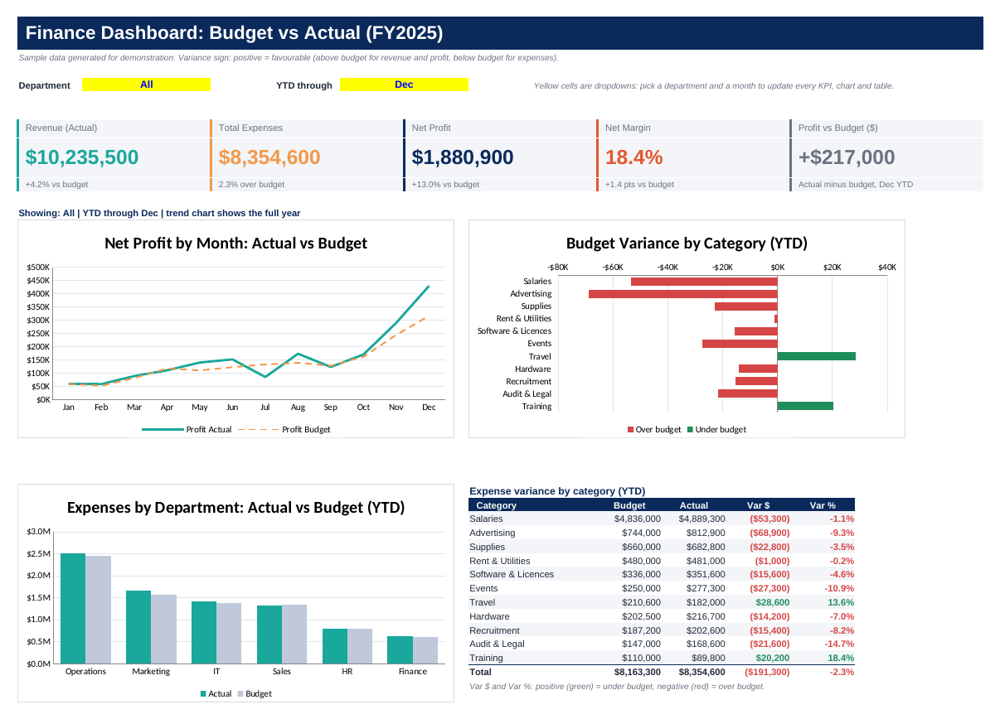

# Finance Dashboard: Budget vs Actual (Excel)

An interactive Excel dashboard that compares budget with actual results for FY2025 and shows where the business is over or under budget. Two dropdowns (Department and YTD month) drive every KPI, chart and table.

## Business Problem

Finance leadership needs to see how the company is performing against budget and quickly find the cost lines that cause overspend. The dashboard answers:

- Are we ahead of or behind budget on revenue, expenses and net profit?
- Which expense categories and departments are over budget?
- How does net profit move month by month compared with plan?

## Data

Sample data generated for demonstration (not real company data). 216 rows: 12 months x 18 department and category lines, in USD. Revenue sits in Sales (Product Sales, Service Fees). Expenses cover Sales, Marketing, Operations, IT, HR and Finance (salaries, advertising, supplies, rent, software, events, travel, hardware, recruitment, training, audit and legal). Budget is a fixed monthly base with seasonality. Actual is Budget times a documented variance factor, so the dashboard tells a realistic story.

## Key Metrics (full year, all departments)

| Metric | Actual | Budget | Variance |
|---|---|---|---|
| Revenue | $10,235,500 | $9,827,200 | +4.2% |
| Expenses | $8,354,600 | $8,163,300 | 2.3% over budget |
| Net profit | $1,880,900 | $1,663,900 | +$217,000 (+13.0%) |
| Net margin | 18.4% | 16.9% | +1.4 pts |

## Key Insights

1. **Profit beat budget by $217K (+13.0%)** because revenue came in 4.2% above plan, more than offsetting a 2.3% expense overrun.
2. **Marketing is the biggest overspend** (about $99.5K over budget), driven by Advertising, which ran about $69K over after September.
3. **Salaries (about $53K over)** and **Events (about $27K over)** are the next largest overruns. Operations salaries rose from June.
4. **Audit and Legal** ran about $22K over, mostly in Q1 (year-end audit work).
5. **Travel (about $29K under) and Training (about $20K under)** are the main savings.
6. **Net profit grows sharply in Q4**, in line with seasonal revenue.

## Recommendations

- Review the Advertising budget and returns, since overspend started in September.
- Check whether the Operations salary increase from June is permanent and re-forecast it.
- Treat Travel and Training savings carefully, because underspend can mean deferred spend.

## Workbook Structure

| Sheet | Purpose |
|---|---|
| Dashboard | KPI cards, three charts, variance table and the two dropdown selectors |
| Data | Source table (`tblFinance`), 216 rows |
| Calc | SUMIFS helper tables that feed the dashboard |
| About | Documentation, assumptions and the colour legend |

## Excel Features Used

- `SUMIFS` with a wildcard criterion (`*`) so "All departments" works with the same formula
- `MATCH`, `IF`, `TEXT`, `MAX` and `MIN`, with zero-safe divisions
- Data validation dropdowns (Department and month)
- Conditional formatting (green favourable, red unfavourable)
- Excel Table (`tblFinance`), charts, merged KPI cards, and a print area for one-page printing
- Colour conventions: blue = hardcoded input, black = formula, green = link to another sheet, yellow = cell to change

## How to Use

1. Open `Finance_Budget_vs_Actual_Dashboard.xlsx` and go to the Dashboard sheet.
2. Pick a department and a month in the yellow cells.
3. The KPIs, charts and tables update. The trend chart always shows the full year.
4. To use your own data, paste rows into the Data sheet with the same columns.

## Variance Convention

Positive (green) = favourable: Actual minus Budget for revenue and profit, Budget minus Actual for expenses.

## Quality Checks

- 683 formulas, 0 errors after recalculation
- KPI results match an independent calculation for two selector settings (All departments through December, and Marketing through June)
- Category and department tables reconcile to the KPI totals

## Tools Used

Microsoft Excel (SUMIFS, data validation, conditional formatting, charts, tables)

## Author

**Shahida Parvin** | LinkedIn: linkedin.com/in/shahida-parvin-7668ba25b | Portfolio: github.com/ShahidaParvin/power-bi-portfolio 
