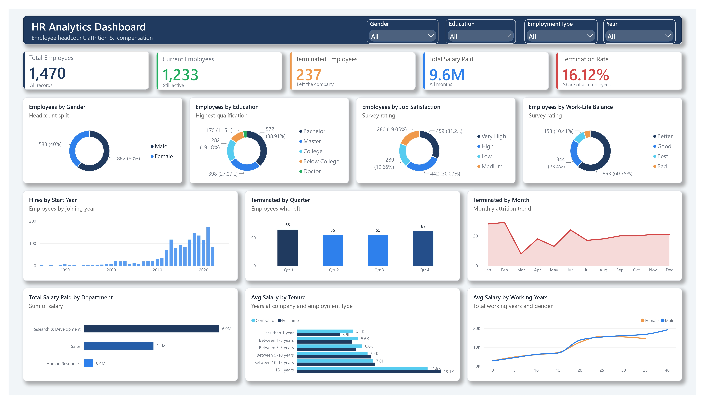

# HR Analytics Dashboard

A single-page, interactive Power BI dashboard covering employee headcount,
attrition and compensation.

------------------------------------------------------------

## Tools
- Power BI Desktop
- DAX
- Power Query

## Key Metrics (KPI Cards)
- Total Employees: 1,470
- Current Employees: 1,233
- Terminated Employees: 237
- Total Salary Paid: 9.6M
- Termination Rate: 16.12%

## Visuals
- Employees by Gender, Education, Job Satisfaction, Work-Life Balance (donuts)
- Hires by Start Year (column chart)
- Terminated by Quarter (column chart)
- Terminated by Month (area/line chart)
- Total Salary Paid by Department (bar chart)
- Avg Salary by Tenure and Employment Type (clustered bar)
- Avg Salary by Working Years and Gender (line chart)
- Slicers: Gender, Education, EmploymentType, Year

## Key Insights
- 16.12% of employees have left the company (237 of 1,470).
- Workforce is 60% male and 40% female.
- Research & Development has the highest salary spend (6.0M).
- Attrition is highest in Q1 (65 employees).
- About 61% of employees rate job satisfaction High or Very High.
- Average salary rises steadily with tenure and working years.
- Hiring grew strongly after 2010.

## DAX Measures (examples)
Total Employees = COUNTROWS(HR)
Terminated Employees = CALCULATE([Total Employees], HR[Attrition] = "Yes")
Current Employees = [Total Employees] - [Terminated Employees]
Termination Rate % = DIVIDE([Terminated Employees], [Total Employees])
Total Salary Paid = SUM(HR[Salary])

## Data
Synthetic (dummy) HR dataset generated for portfolio purposes.
Stored in Excel, then cleaned and modeled in Power Query.
No real employee data is used.

## How to Open
Download `HR_Analytics_Dashboard.pbix` and open it in
Power BI Desktop (free).

## Author
Shahida
GitHub: github.com/ShahidaParvin
