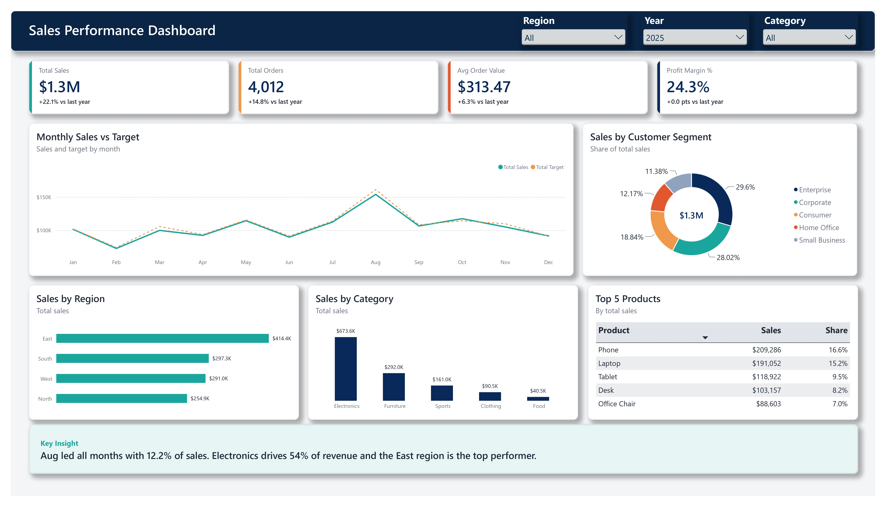

# Sales Performance Dashboard

A single-page, interactive Power BI dashboard that tracks sales against
target and breaks performance down by region, category, customer segment
and product.

------------------------------------------------------------

## Tools
- Power BI Desktop
- DAX
- Power Query

## Key Metrics (KPI Cards)
- Total Sales: $1.3M (+22.1% vs last year)
- Total Orders: 4,012 (+14.8% vs last year)
- Avg Order Value: $313.47 (+6.3% vs last year)
- Profit Margin: 24.3%

## Visuals
- Monthly Sales vs Target (line chart)
- Sales by Customer Segment (donut chart)
- Sales by Region (bar chart)
- Sales by Category (column chart)
- Top 5 Products (table)
- Slicers: Region, Year, Category

## Key Insights
- August was the best month, with 12.2% of annual sales.
- Electronics drives about 54% of revenue.
- East is the top region ($414.4K).
- Phone and Laptop are the top products (31.8% of sales combined).
- Enterprise and Corporate segments make up about 58% of sales.
- Monthly sales track close to target throughout the year.

## DAX Measures (examples)
Total Sales = SUM(Sales[SalesAmount])
Total Orders = DISTINCTCOUNT(Sales[OrderID])
Avg Order Value = DIVIDE([Total Sales], [Total Orders])
Profit Margin % = DIVIDE(SUM(Sales[Profit]), [Total Sales])
Sales LY = CALCULATE([Total Sales], SAMEPERIODLASTYEAR('Date'[Date]))
YoY Growth % = DIVIDE([Total Sales] - [Sales LY], [Sales LY])

## Data
Synthetic (dummy) sales dataset generated for portfolio purposes.
Stored in Excel, then cleaned and modeled in Power Query.
No real company or customer data is used.

## How to Open
Download `Sales_Performance_Dashboard.pbix` and open it in
Power BI Desktop (free).

## Author
Shahida Parvin
GitHub: github.com/ShahidaParvin
